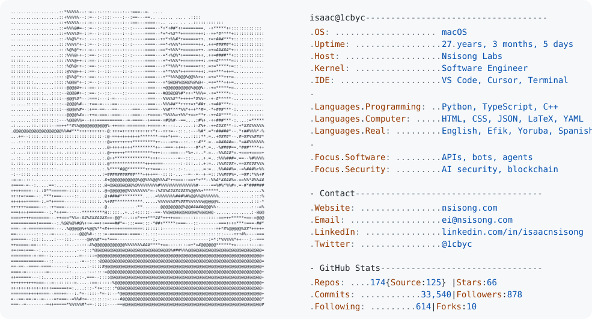

<a href="https://github.com/1cbyc/1cbyc">
  <picture>
    <source media="(prefers-color-scheme: dark)" srcset="https://raw.githubusercontent.com/1cbyc/1cbyc/main/assets/dark_mode.svg">
    
  </picture>
</a>

# Isaac Emmanuel

Senior backend engineer and technical lead building reliable APIs, automation systems, AI security infrastructure, and developer tooling.

I work primarily with **Python**, **TypeScript**, **FastAPI**, **NestJS**, **PostgreSQL**, **Docker**, and **GitHub Actions**. My recent work spans production AI workflows, prompt-injection and PII protections, healthcare integrations, fintech systems, and internal tools that make operational work safer and faster.

## What I am working on

- Backend systems and APIs that remain observable and maintainable in production
- AI applications with evaluation, guardrails, retrieval, and clear failure handling
- Automation and developer tools that remove repetitive operational work
- Security-minded infrastructure, CI/CD, and data workflows

## Selected work

- [Koreshield](https://koreshield.com) — AI security proxy for prompt-injection detection, PII redaction, policy checks, audit logging, and provider routing
- [salonbook](https://salonbook.xyz) — operations platform for appointments, sales, customers, and day-to-day business workflow
- [Nsisong Labs](https://nsisong.com) — engineering studio and technical notes

## Connect

- [Website](https://nsisong.com)
- [LinkedIn](https://linkedin.com/in/isaacnsisong)
- [Email](mailto:ei@nsisong.com)

I am interested in thoughtful collaborations around backend engineering, AI infrastructure, automation, and developer tools.
